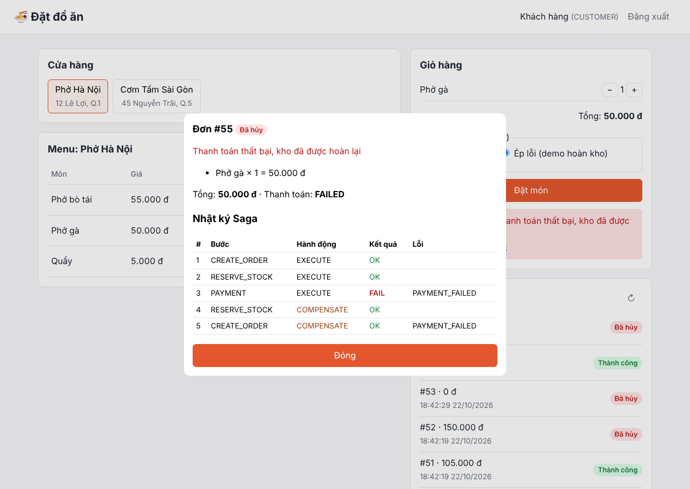
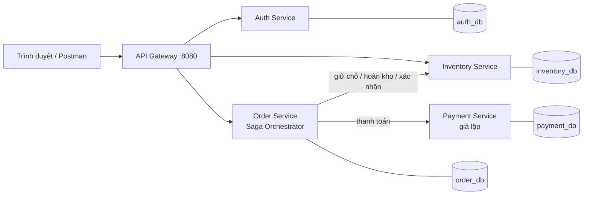

# Hệ thống đặt đồ ăn trực tuyến

Đồ án Microservices, hướng **Giao dịch phân tán & Xử lý đồng thời**.

Hệ thống gồm **1 API Gateway** và **4 service** (Auth, Inventory/Catalog, Order, Payment). Mỗi service có database PostgreSQL riêng. Đơn hàng được xử lý bằng **Saga (Orchestration)**: nếu thanh toán lỗi sau khi kho đã bị trừ, hệ thống tự hoàn kho và hủy đơn. Việc chống bán vượt khi nhiều người đặt cùng lúc dùng câu lệnh cập nhật có điều kiện trong database. Toàn bộ chạy bằng **một lệnh Docker Compose**, có sẵn giao diện web và dữ liệu mẫu.



## Mục lục

1. [Yêu cầu cài đặt](#1-yêu-cầu-cài-đặt)
2. [Chạy hệ thống](#2-chạy-hệ-thống)
3. [Tài khoản mẫu và dữ liệu mẫu](#3-tài-khoản-mẫu-và-dữ-liệu-mẫu)
4. [Kịch bản demo](#4-kịch-bản-demo)
5. [Kiến trúc](#5-kiến-trúc)
6. [Danh sách API](#6-danh-sách-api)
7. [Cấu trúc thư mục](#7-cấu-trúc-thư-mục)
8. [Xử lý sự cố](#8-xử-lý-sự-cố)
9. [Phạm vi và hướng phát triển](#9-phạm-vi-và-hướng-phát-triển)

Tài liệu kèm theo:
- [docs/thiet-ke.md](docs/thiet-ke.md): sơ đồ kiến trúc, ERD, state machine, sequence diagram Saga (dùng cho báo cáo).
- [docs/huong-dan-chia-code.md](docs/huong-dan-chia-code.md): chia phần code cho từng thành viên, câu hỏi bảo vệ thường gặp.

## 1. Yêu cầu cài đặt

| Phần mềm | Ghi chú |
|----------|---------|
| [Docker Desktop](https://www.docker.com/products/docker-desktop/) (Windows/macOS) hoặc Docker Engine + Compose (Linux) | Bắt buộc. Không cần cài Node.js hay PostgreSQL riêng. |
| Node.js 18 trở lên | Chỉ cần nếu muốn chạy script test đồng thời trên máy. |
| Cổng **8080** còn trống | Đây là cổng duy nhất hệ thống mở ra ngoài. |

## 2. Chạy hệ thống

```bash
git clone https://github.com/Durian-Knight/food-ordering.git
cd food-ordering
cp .env.example .env          # Windows PowerShell: copy .env.example .env
docker compose up --build
```

Lần đầu mất vài phút để tải image và cài thư viện. Khi log hiện `gateway chạy ở cổng 8080` là xong.

- **Giao diện web:** http://localhost:8080
- **Kiểm tra sức khỏe:** http://localhost:8080/health phải trả về cả 4 service `UP`.

Tắt hệ thống: `Ctrl + C`, hoặc chạy `docker compose down`.
Xóa sạch dữ liệu để nạp lại dữ liệu mẫu: `docker compose down -v` rồi chạy lại `docker compose up`.

## 3. Tài khoản mẫu và dữ liệu mẫu

Mật khẩu của cả 3 tài khoản đều là `123456`.

| Email | Vai trò | Dùng để |
|-------|---------|---------|
| `khach@food.vn` | CUSTOMER | Đặt món, xem đơn của mình |
| `chuquan@food.vn` | STORE_OWNER | Chủ 2 cửa hàng mẫu, sửa được tồn kho (nút ✎ trên menu) |
| `admin@food.vn` | ADMIN | Xem tất cả đơn, sửa tồn kho mọi cửa hàng |

Dữ liệu mẫu gồm 2 cửa hàng (*Phở Hà Nội*, *Cơm Tấm Sài Gòn*) và 6 món. Món **Phở bò tái** chỉ có 10 phần, dùng để demo chống bán vượt.

Bạn cũng có thể tự đăng ký tài khoản mới (vai trò CUSTOMER) ngay trên giao diện.

## 4. Kịch bản demo

### Kịch bản 1: Đặt món thành công

1. Mở http://localhost:8080 và đăng nhập `khach@food.vn`.
2. Chọn cửa hàng, bấm **+ Thêm** vài món, để mục thanh toán ở **Thành công**, rồi bấm **Đặt món**.
3. Kết quả: báo *Đặt món thành công*, đơn có nhãn **Thành công**. Bấm **↻ Tải lại tồn kho** sẽ thấy cột *Còn* đã giảm.

### Kịch bản 2: Thanh toán lỗi, hệ thống tự hoàn kho (trọng tâm)

1. Ghi lại số *Còn* của một món, ví dụ *Phở gà*.
2. Thêm món đó vào giỏ, chọn **Ép lỗi (demo hoàn kho)**, rồi bấm **Đặt món**.
3. Kết quả: báo *Thanh toán thất bại, kho đã được hoàn lại*. Số *Còn* trở về như cũ.
4. Bấm **Xem các bước Saga** để thấy nhật ký từng bước:

| # | Bước | Hành động | Kết quả |
|---|------|-----------|---------|
| 1 | CREATE_ORDER | EXECUTE | OK |
| 2 | RESERVE_STOCK | EXECUTE | OK (kho đã bị trừ) |
| 3 | PAYMENT | EXECUTE | **FAIL** |
| 4 | RESERVE_STOCK | COMPENSATE | OK (hoàn kho) |
| 5 | CREATE_ORDER | COMPENSATE | OK (hủy đơn) |

### Kịch bản 3: Nhiều người đặt cùng lúc, không bán vượt

Khi hệ thống đang chạy, mở một cửa sổ terminal khác:

```bash
node scripts/concurrency-test.mjs
```

Script đặt kho *Phở bò tái* về 10 phần, rồi gửi 50 đơn cùng lúc, mỗi đơn 1 phần. Kết quả đúng:

```
┌────────────────────────┬────────┐
│ CONFIRMED              │ 10     │
│ CANCELLED OUT_OF_STOCK │ 40     │
└────────────────────────┴────────┘
Sau: còn 0, đang giữ 0
ĐẠT: không bán vượt
```

### Kịch bản 4: API Gateway bảo vệ hệ thống

```bash
curl -i localhost:8080/api/orders                    # 401: chưa đăng nhập
curl -i -X POST localhost:8080/api/reservations      # 404: API nội bộ, không mở ra ngoài
curl -i -X POST localhost:8080/api/payments          # 404: chỉ Order Service được gọi thanh toán
```

### Thử bằng curl (không cần giao diện)

```bash
TOKEN=$(curl -s -X POST localhost:8080/api/auth/login -H 'content-type: application/json' \
  -d '{"email":"khach@food.vn","password":"123456"}' | sed 's/.*"accessToken":"\([^"]*\)".*/\1/')

# Đặt món thành công: 201, status CONFIRMED
curl -X POST localhost:8080/api/orders -H "Authorization: Bearer $TOKEN" -H 'content-type: application/json' \
  -d '{"items":[{"itemId":2,"qty":2}]}'

# Ép thanh toán lỗi: 409, status CANCELLED, có sagaLog trong kết quả
curl -X POST localhost:8080/api/orders -H "Authorization: Bearer $TOKEN" -H 'content-type: application/json' \
  -d '{"items":[{"itemId":2,"qty":2}],"simulatePaymentFail":true}'
```

## 5. Kiến trúc



| Thành phần | Vai trò |
|------------|---------|
| **API Gateway** | Cổng vào duy nhất. Kiểm tra JWT, định tuyến tới đúng service, chặn API nội bộ, gắn mã theo dõi `X-Request-Id`. Phục vụ luôn giao diện web. |
| **Auth Service** | Đăng ký, đăng nhập, mã hóa mật khẩu bằng bcrypt, cấp JWT. |
| **Inventory/Catalog Service** | Cửa hàng, món ăn, tồn kho. Giữ chỗ, hoàn kho, xác nhận cho Saga. Chống bán vượt. |
| **Order Service** | Tạo đơn và **điều phối Saga**: giữ hàng, gọi thanh toán, hoàn tác khi lỗi. Lưu nhật ký từng bước. |
| **Payment Service** | Thanh toán giả lập, có tùy chọn ép lỗi để demo. |

Các điểm kỹ thuật chính:
- **Database per service:** 1 container PostgreSQL chứa 4 database và 4 user riêng. User của service này không có quyền kết nối vào database của service khác.
- **Saga Orchestration:** Order Service điều phối 4 bước, mỗi bước có hành động hoàn tác tương ứng. Chi tiết và sequence diagram có trong [docs/thiet-ke.md](docs/thiet-ke.md).
- **Chống bán vượt:** `UPDATE stock SET available = available - qty WHERE item_id = ? AND available >= qty`. Nếu không cập nhật được dòng nào thì báo hết hàng và rollback cả đơn. Đơn nhiều món được khóa theo thứ tự `item_id` tăng dần để tránh deadlock.
- **Gọi lặp an toàn:** mỗi đơn chỉ giữ chỗ và thanh toán được 1 lần (`UNIQUE(order_id)`). Gọi hoàn kho nhiều lần cũng không cộng kho 2 lần.

## 6. Danh sách API

Tất cả gọi qua Gateway `http://localhost:8080`.

| Method | Đường dẫn | Cần đăng nhập | Mô tả |
|--------|-----------|:-------------:|-------|
| POST | `/api/auth/register` | | Đăng ký `{email, password, fullName}` |
| POST | `/api/auth/login` | | Đăng nhập `{email, password}`, trả `accessToken` |
| GET | `/api/auth/me` | ✓ | Thông tin tài khoản đang đăng nhập |
| GET | `/api/stores` | | Danh sách cửa hàng |
| GET | `/api/stores/:id/menu` | | Menu kèm tồn kho (`available`, `reserved`) |
| GET | `/api/items/:id` | | Chi tiết 1 món |
| POST | `/api/stores/:id/items` | ✓ chủ quán/admin | Thêm món `{name, price, available}` |
| PUT | `/api/items/:id/stock` | ✓ chủ quán/admin | Đặt lại tồn kho `{available}` |
| POST | `/api/orders` | ✓ | Đặt món `{items: [{itemId, qty}], simulatePaymentFail?}` |
| GET | `/api/orders` | ✓ | Đơn của tôi (admin thấy tất cả) |
| GET | `/api/orders/:id` | ✓ | Chi tiết đơn kèm `sagaLog` |
| GET | `/api/payments/:orderId` | ✓ | Trạng thái thanh toán của đơn |

Kết quả `POST /api/orders`: **201** khi đơn `CONFIRMED`, **409** khi đơn `CANCELLED` (hết hàng hoặc thanh toán lỗi), **400** khi dữ liệu sai.

## 7. Cấu trúc thư mục

```
food-ordering/
├── docker-compose.yml        Khai báo 6 container, chạy bằng 1 lệnh
├── .env.example              Mật khẩu DB, khóa JWT (copy thành .env)
├── infra/postgres/init.sh    Tạo 4 database + 4 user riêng
├── gateway/                  API Gateway (:8080)
│   └── src/public/           Giao diện web (HTML/CSS/JS thuần)
├── auth-service/             Auth Service (:3001, auth_db)
├── inventory-service/        Inventory/Catalog Service (:3002, inventory_db)
├── order-service/            Order Service + Saga (:3003, order_db)
│   └── src/saga.js           Toàn bộ logic Saga nằm ở file này
├── payment-service/          Payment Service giả lập (:3004, payment_db)
├── scripts/                  Script test đồng thời
└── docs/                     Thiết kế, ảnh chụp màn hình, hướng dẫn chia code
```

Mỗi service có cấu trúc giống nhau: `src/index.js` chứa các API, `src/db/schema.sql` chứa các bảng (tự tạo khi service khởi động), `Dockerfile` dùng để build. Công nghệ dùng: Node.js 20, Express 5, PostgreSQL 16, JWT, bcrypt.

## 8. Xử lý sự cố

| Hiện tượng | Cách xử lý |
|------------|------------|
| `port 8080 is already allocated` | Tắt chương trình đang dùng cổng 8080, hoặc sửa `"8080:8080"` thành `"8081:8080"` trong `docker-compose.yml` rồi mở http://localhost:8081 |
| `/health` báo một service `DOWN` | Xem log: `docker compose logs <tên-service>`, ví dụ `docker compose logs order-service` |
| Sửa `.env` nhưng service không kết nối được DB | Mật khẩu DB chỉ áp dụng khi tạo volume lần đầu. Chạy `docker compose down -v` rồi `up` lại |
| Muốn dữ liệu về như ban đầu | `docker compose down -v` rồi `docker compose up` |
| Script test báo lỗi `fetch is not defined` | Cần Node.js 18 trở lên (`node -v` để kiểm tra) |
| Giao diện vẫn hiện tài khoản cũ sau khi reset dữ liệu | Bấm **Đăng xuất** rồi đăng nhập lại |

## 9. Phạm vi và hướng phát triển

**Đã làm:** API Gateway, 4 service với database riêng, Saga có hoàn tác khi thanh toán lỗi, chống bán vượt khi đặt đồng thời, giao diện web, dữ liệu mẫu, chạy bằng Docker Compose.

**Chưa làm (hướng phát triển, nêu trong báo cáo):**
- Tự thử lại (retry) và job tự phục hồi khi chính bước hoàn kho bị lỗi. Hiện tại nếu Inventory sập đúng lúc hoàn tác, đơn sẽ dừng ở trạng thái `COMPENSATING` và cần xử lý tay.
- Giữ chỗ có thời hạn (tự nhả hàng khi quá hạn).
- Refresh token, giới hạn tần suất gọi (rate limit).
- Message queue (RabbitMQ) và Outbox pattern để Saga chạy bất đồng bộ.
- Thanh toán thật, giao hàng, đánh giá, khuyến mãi.
