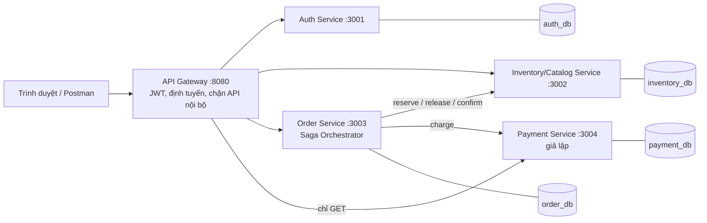
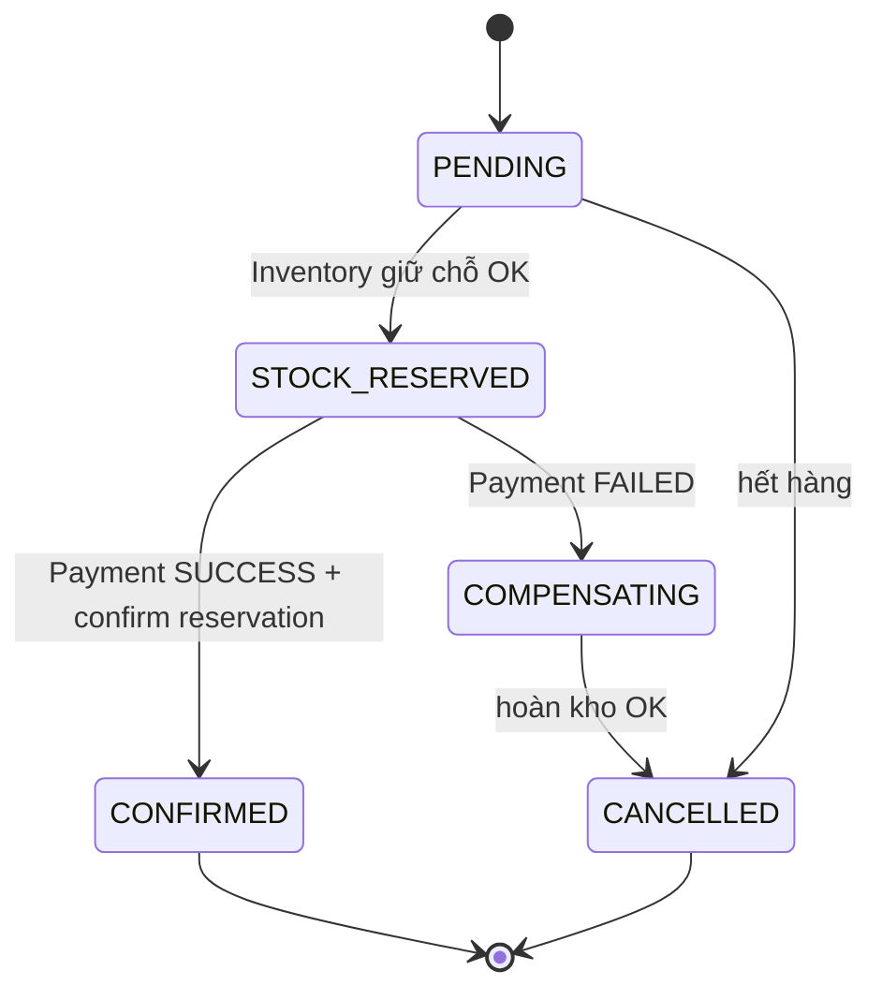
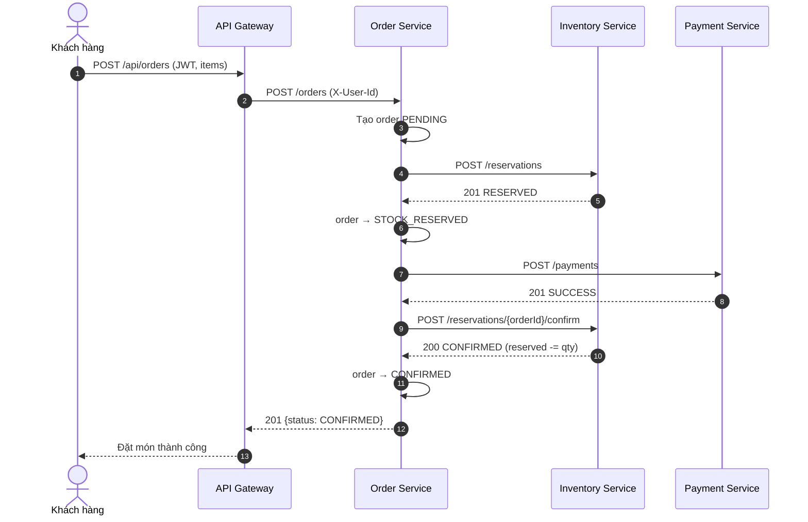

# Thiết kế hệ thống đặt đồ ăn

Bản đơn giản theo `bao-gia-hang-muc.xlsx`: không có refresh token, rate limit, retry/job phục hồi, Idempotency-Key, RabbitMQ.

## 1. Kiến trúc



- Client chỉ nói chuyện với Gateway. Chỉ Gateway mở cổng ra ngoài (8080).
- 1 container PostgreSQL, 4 database, 4 user riêng; user của service này **không có quyền CONNECT** vào database của service khác (database per service).
- Gateway tự gắn `X-User-Id`, `X-User-Role`, `X-Request-Id` sau khi kiểm tra JWT, và xóa các header này nếu client tự gửi.

## 2. ERD (mỗi khung là 1 database riêng)

```mermaid
erDiagram
    USERS { int id PK; text email UK; text password_hash; text full_name; text role }

    STORES ||--o{ MENU_ITEMS : co
    MENU_ITEMS ||--|| STOCK : ton_kho
    RESERVATIONS ||--|{ RESERVATION_ITEMS : gom
    MENU_ITEMS ||--o{ RESERVATION_ITEMS : duoc_giu
    STORES { int id PK; text name; text address; int owner_id; bool is_open }
    MENU_ITEMS { int id PK; int store_id FK; text name; int price; bool is_active }
    STOCK { int item_id PK; int available; int reserved }
    RESERVATIONS { int id PK; int order_id UK; text status }
    RESERVATION_ITEMS { int reservation_id PK; int item_id PK; int qty }

    ORDERS ||--|{ ORDER_ITEMS : gom
    ORDERS ||--o{ SAGA_LOG : ghi
    ORDERS { int id PK; int user_id; int store_id; int total_amount; text status; text cancel_reason }
    ORDER_ITEMS { int order_id PK; int item_id PK; text name_snapshot; int price_snapshot; int qty }
    SAGA_LOG { int id PK; int order_id FK; text step; text action; text result; text error }

    PAYMENTS { int id PK; int order_id UK; int amount; text status; text failure_reason }
```

Không có khóa ngoại giữa các database (vd. `orders.user_id` không trỏ sang `auth_db.users`): liên kết giữa service chỉ qua API.

## 3. Trạng thái đơn hàng



## 4. Saga (Orchestration, đặt trong Order Service)

| Bước | Thực hiện | Hoàn tác |
|------|-----------|----------|
| 1 | Order: tạo đơn `PENDING` | Đơn → `CANCELLED` |
| 2 | Inventory `POST /reservations`: `available -= qty`, `reserved += qty` | `POST /reservations/:orderId/release`: `available += qty`, `reserved -= qty` |
| 3 | Payment `POST /payments` | (bước cuối, không cần hoàn tác) |
| 4 | Inventory `POST /reservations/:orderId/confirm`: `reserved -= qty` | không có |

Giới hạn của bản đơn giản (không có retry/job phục hồi):
- Nếu hoàn kho thất bại (Inventory sập đúng lúc đó), đơn dừng ở `COMPENSATING` và `saga_log` ghi `RESERVE_STOCK COMPENSATE FAIL`, cần xử lý tay.
- Nếu confirm thất bại sau khi đã thu tiền, đơn vẫn `CONFIRMED` (tiền đã thu), `saga_log` ghi `CONFIRM_STOCK FAIL`.
- Nếu gọi Inventory bị timeout lúc giữ chỗ, Order gọi release luôn cho chắc rồi hủy đơn.

### Sequence diagram: Payment lỗi sau khi Inventory đã trừ kho

```mermaid
sequenceDiagram
    autonumber
    actor U as Khách hàng
    participant GW as API Gateway
    participant O as Order Service<br/>(Saga Orchestrator)
    participant I as Inventory Service
    participant P as Payment Service

    U->>GW: POST /api/orders (JWT, items, simulateFail)
    GW->>GW: Kiểm tra JWT, gắn X-User-Id
    GW->>O: POST /orders
    O->>O: Tạo order PENDING, saga_log(CREATE_ORDER, EXECUTE, OK)
    O->>I: POST /reservations {orderId, items}
    I->>I: BEGIN; UPDATE stock SET available = available - qty, reserved = reserved + qty<br/>WHERE item_id = ? AND available >= qty; tạo reservation RESERVED; COMMIT
    I-->>O: 201 RESERVED (kho đã bị trừ)
    O->>O: order → STOCK_RESERVED, saga_log(RESERVE_STOCK, EXECUTE, OK)
    O->>P: POST /payments {orderId, amount, simulateFail}
    P->>P: Lưu payment FAILED
    P-->>O: 402 PAYMENT_FAILED
    Note over O: Payment lỗi → bắt đầu bù trừ
    O->>O: order → COMPENSATING, saga_log(PAYMENT, EXECUTE, FAIL)
    O->>I: POST /reservations/{orderId}/release
    I->>I: Nếu đã RELEASED → trả OK luôn<br/>Ngược lại: available += qty, reserved -= qty, status = RELEASED
    I-->>O: 200 RELEASED
    O->>O: order → CANCELLED, saga_log(RESERVE_STOCK, COMPENSATE, OK)
    O-->>GW: 409 {status: CANCELLED, reason: PAYMENT_FAILED}
    GW-->>U: Thanh toán thất bại, đơn đã hủy, kho đã hoàn lại
```

### Sequence diagram: Happy path



## 5. Chống bán vượt (oversell)

```sql
UPDATE stock SET available = available - $qty, reserved = reserved + $qty
WHERE item_id = $id AND available >= $qty;
-- rowCount = 0 → hết hàng → ROLLBACK cả transaction, trả 409 OUT_OF_STOCK
```

Đơn nhiều món: chạy trong 1 transaction, sắp xếp `item_id` tăng dần trước khi update để tránh deadlock. Cột `CHECK (available >= 0)` là lớp bảo vệ cuối ở mức database.

## 6. API qua Gateway

| Method | Đường dẫn | Service | Cần JWT |
|--------|-----------|---------|---------|
| POST | `/api/auth/register`, `/api/auth/login` | Auth | Không |
| GET | `/api/auth/me` | Auth | Có |
| GET | `/api/stores`, `/api/stores/:id/menu`, `/api/items/...` | Inventory | Không |
| POST/PUT | `/api/stores/...`, `/api/items/:id/stock` | Inventory | Có (STORE_OWNER/ADMIN) |
| GET/POST | `/api/orders`, `/api/orders/:id` | Order | Có |
| GET | `/api/payments/:orderId` | Payment | Có |

API nội bộ, Gateway trả 404: `/reservations/*`, `POST /payments`.
